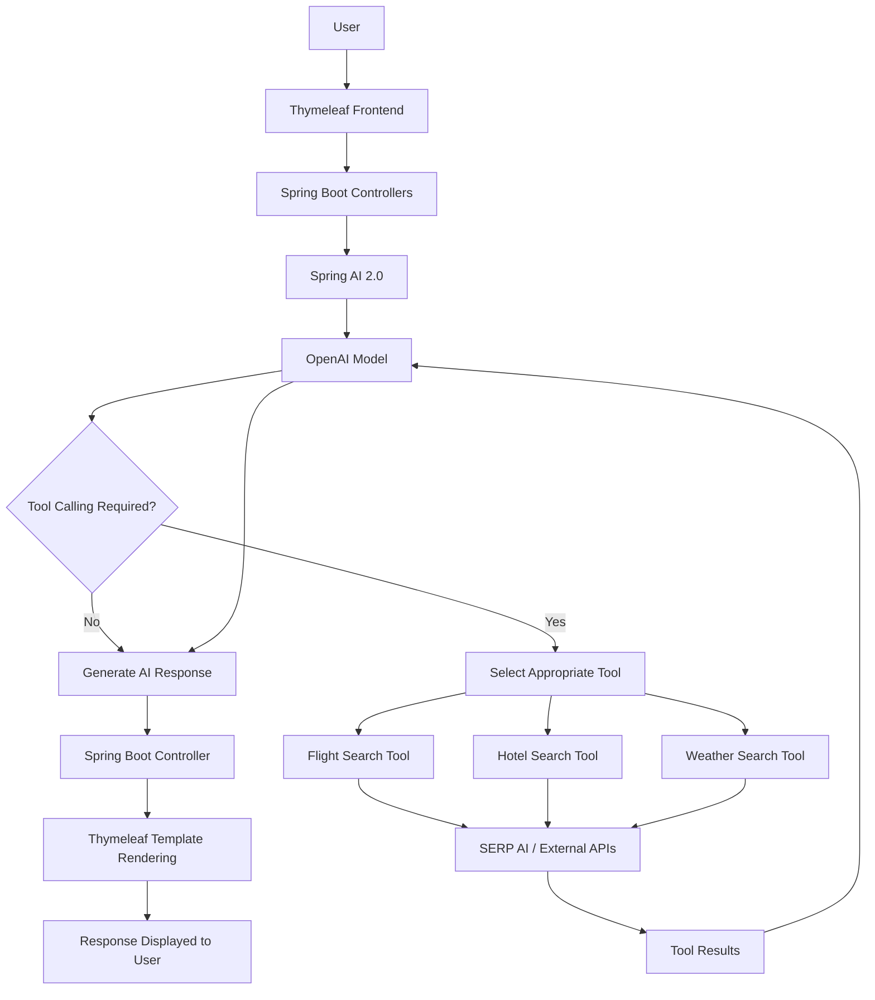

# ✈️ Travel AI Agent

### An Intelligent AI-Powered Travel Planning Assistant

Travel AI Agent is an AI-powered travel assistant built using **Spring Boot 4, Spring AI 2.0, OpenAI Models, and Thymeleaf**. It leverages Large Language Models (LLMs) and intelligent tool calling to interact with external services through SERP AI, providing users with travel-related information such as flights, hotels, and weather through natural language conversations.

Instead of manually searching across multiple platforms, users can interact with an intelligent AI agent that understands their requirements, determines which tools are needed, retrieves relevant external information, and generates contextual responses.

---

## 🌍 Overview

Planning a trip involves gathering information from multiple sources, including flight availability, accommodation options, and weather conditions.

Travel AI Agent simplifies this process by combining the reasoning capabilities of Large Language Models with external API integrations through AI-powered tool calling.

The application uses **Spring AI's tool-calling capabilities** to allow OpenAI models to decide when external tools should be invoked based on the user's query.

For example, when a user asks:

> Find flights from Mumbai to Delhi, suggest hotels in Delhi, and tell me the weather there.

The AI agent can identify the required information, invoke the corresponding flight, hotel, and weather tools, process their responses, and present the information in a conversational format.

## ✨ Key Features

- **AI-Powered Conversational Interface:** Interact with the travel assistant using natural language.
- **LLM-Based Tool Calling:** OpenAI models dynamically determine when external tools are required to answer user queries.
- **Flight Information:** Retrieve flight-related information using integrated SERP AI tools.
- **Hotel Information:** Search for hotel and accommodation information based on travel requirements.
- **Weather Information:** Retrieve weather information for travel destinations.
- **External API Integration:** Connect external travel information services through SERP AI integrations.
- **Contextual AI Responses:** Combine information retrieved from external tools with LLM capabilities to generate meaningful responses.
- **Intelligent Tool Selection:** The model selects relevant tools based on the context and intent of the user's request.
- **Server-Side Rendering:** Thymeleaf provides dynamic HTML rendering for the application's user interface.

## 🛠️ Technology Stack

| Technology | Purpose |
|---|---|
| Java | Primary programming language |
| Spring Boot 4 | Backend application framework |
| Spring AI 2.0 | AI integration and tool-calling orchestration |
| OpenAI Models | Natural language understanding and response generation |
| SERP AI | External flight, hotel, and weather information retrieval |
| Thymeleaf | Server-side HTML templating and frontend rendering |
| HTML, CSS, JavaScript | Frontend structure, styling, and interactions |
| Maven | Dependency management and build automation |

## 🏗️ System Architecture

The application follows an AI-agent-based architecture where the LLM acts as the central decision-making component.

Thymeleaf provides the frontend, Spring Boot manages application requests and backend operations, and Spring AI orchestrates interactions between OpenAI models and external tools.

### High-Level Architecture

## Deployed Version:

🧳<a href="https://travelaiagent-2dn7.onrender.com/" target="_blank">
   Travel AI Agent
</a>

## Demonstration:

